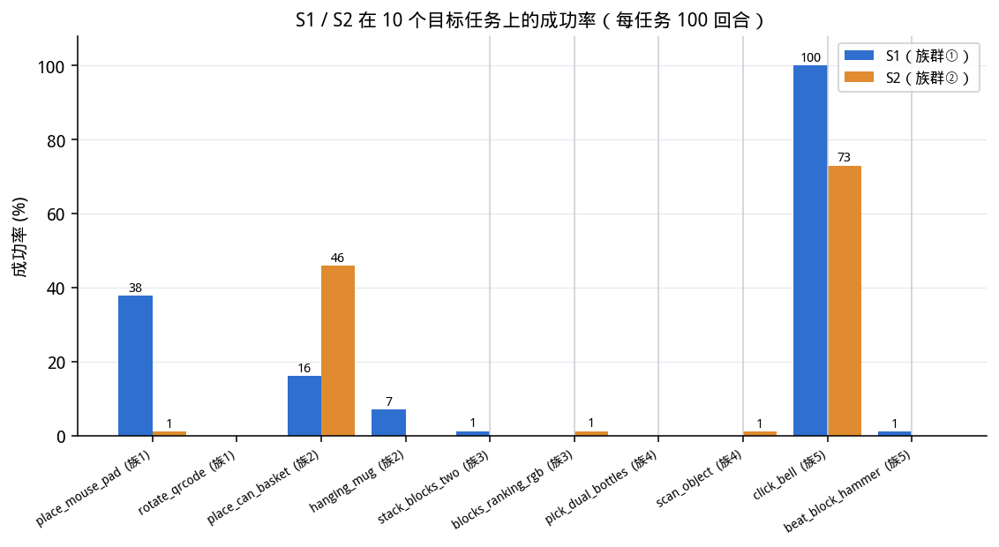
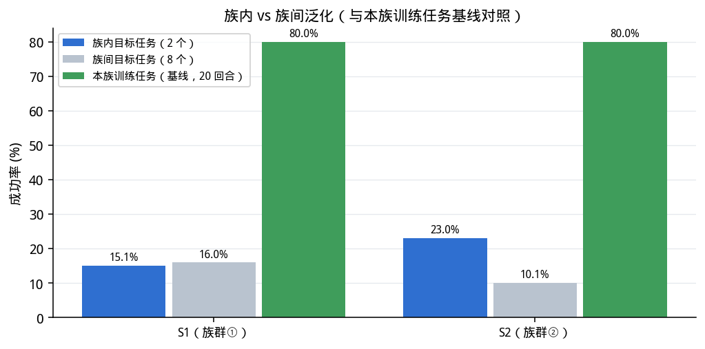
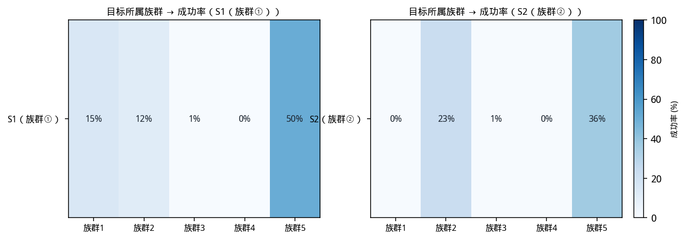
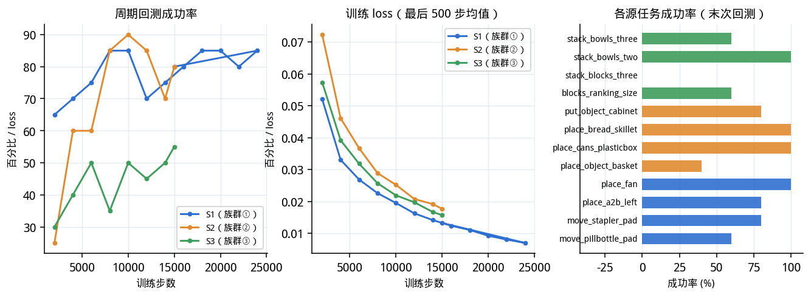

更新时间（带时区）: 2026-10-23T09:53:28+0000

# 源模型跨任务泛化测试报告（服务器 A）

## 测试设置

- 模型: S1（族群① 搬运定位）, S2（族群② 容器复合）（各自训练于 4 个源任务 × 50 条示范，官方超参、15000 步）
- 任务: 10 个目标测试任务（族群①–⑤ 各 2 个）
- 回合: 每模型每任务 100 回合，共 2 × 10 × 100 = 2000 回合
- 场景种子: `100000 + 1000*t + i`（同一目标对所有模型使用同一组种子，构成配对比较）
- 评测配置: RoboTwin aloha-agilex 仿真环境，与训练一致的相机/动作定义与控制频率；每回合独立重置
- 说明: 本轮不做最终评估的 0 步裸测；微调矩阵已按运营指示在保存权重后停止

## 逐任务成功率

| 目标任务 | 所属族群 | S1（族群① 搬运定位） | S2（族群② 容器复合） |
|---|---|---|---|
| `place_mouse_pad` | 族群1 | 25/66（38%） | 1/100（1%） |
| `rotate_qrcode` | 族群1 | 0/100（0%） | 0/100（0%） |
| `place_can_basket` | 族群2 | 16/100（16%） | 46/100（46%） |
| `hanging_mug` | 族群2 | 7/100（7%） | 0/100（0%） |
| `stack_blocks_two` | 族群3 | 1/83（1%） | 0/67（0%） |
| `blocks_ranking_rgb` | 族群3 | 0/100（0%） | 1/84（1%） |
| `pick_dual_bottles` | 族群4 | 0/100（0%） | 0/100（0%） |
| `scan_object` | 族群4 | 0/100（0%） | 1/100（1%） |
| `click_bell` | 族群5 | 100/100（100%） | 73/100（73%） |
| `beat_block_hammer` | 族群5 | 1/100（1%） | 0/100（0%） |
| **全部 10 个任务** | - | **150/949（15.8%）** | **122/951（12.8%）** |

## 族内泛化 vs 族间泛化

「族内」= 测试任务与模型训练用的族群相同；「族间」= 测试任务属于其它族群（未见过的任务）。

| 模型 | 训练族群 | 族内任务 | 族内成功率 | 族间任务 | 族间成功率 | 族内-族间差 | 本族训练任务成功率 |
|---|---|---|---:|---|---:|---:|---:|
| S1（族群① 搬运定位） | 族群1 | `place_mouse_pad`, `rotate_qrcode` | 15.1%（25/166） | 8 个任务 | 16.0%（125/783） | -0.9 pt | 80.0%（move_pillbottle_pad 3/5，move_stapler_pad 4/5，place_a2b_left 4/5，place_fan 5/5） |
| S2（族群② 容器复合） | 族群2 | `place_can_basket`, `hanging_mug` | 23.0%（46/200） | 8 个任务 | 10.1%（76/751） | +12.9 pt | 80.0%（place_object_basket 2/5，place_cans_plasticbox 5/5，place_bread_skillet 5/5，put_object_cabinet 4/5） |

## 族群 × 族群 转移矩阵（目标任务所属族群 → 成功率）

| 模型 | 族群1（2 个任务） | 族群2（2 个任务） | 族群3（2 个任务） | 族群4（2 个任务） | 族群5（2 个任务） |
|---|---|---|---|---|---|
| S1（族群① 搬运定位） | 15.1%（25/166） | 11.5%（23/200） | 0.5%（1/183） | 0.0%（0/200） | 50.5%（101/200） |
| S2（族群② 容器复合） | 0.5%（1/200） | 23.0%（46/200） | 0.7%（1/151） | 0.5%（1/200） | 36.5%（73/200） |

## 源模型训练过程（周期回测）

## 结论要点

- **S1（族群① 搬运定位）**：本族训练任务 80.0% → 族内目标任务 15.1% → 族间目标任务 16.0%；族内相对族间 -0.9 pt，相对本族训练任务 -64.9 pt。
- **S2（族群② 容器复合）**：本族训练任务 80.0% → 族内目标任务 23.0% → 族间目标任务 10.1%；族内相对族间 +12.9 pt，相对本族训练任务 -57.0 pt。
- 族内与族间之差即「同族技能迁移」的幅度；相对本族训练任务的下降即「同族任务之间的分布差」幅度。
- 样本口径: 每格 100 回合（族内格为 200 回合，族间格为 800 回合）；同一目标在两个模型上使用同一组场景种子，可直接配对比较。

